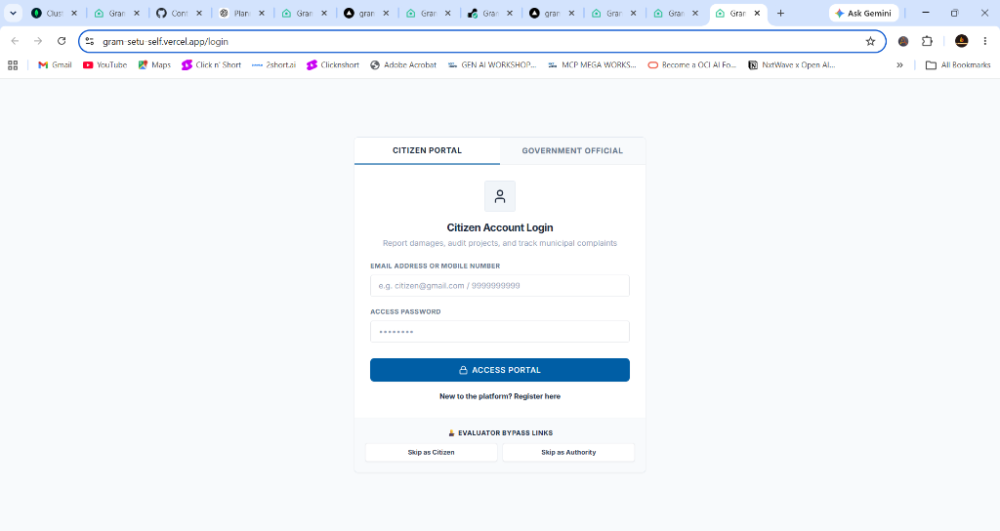
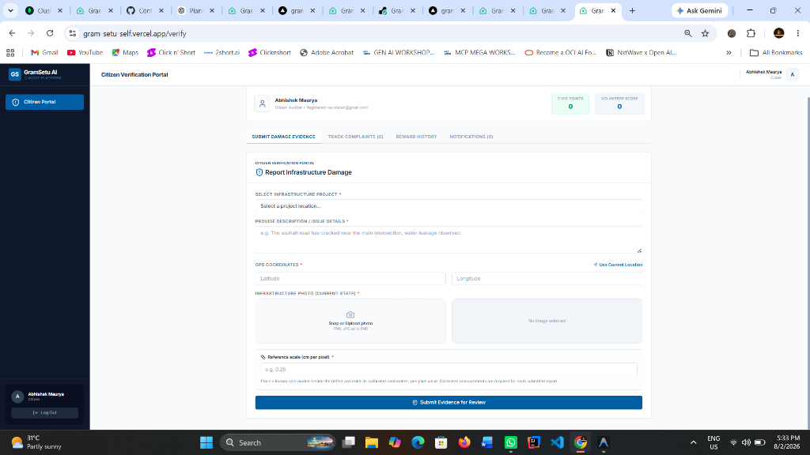
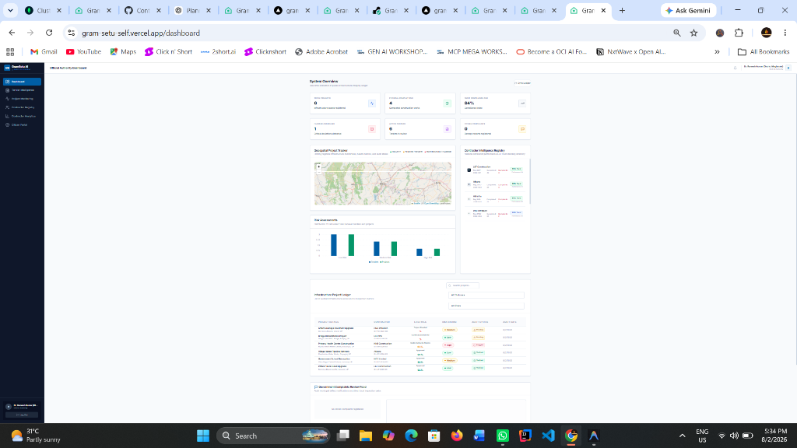

# GramSetu

**Civic infrastructure reporting and verification.** Citizens report problems
with public works (potholes, open manholes, broken facilities) with a photo and
a location. Officials assign an inspector, review the evidence and publish a
decision. Project completion is checked by comparing before/after photos.
Contractors get a score from verified evidence only.

Built for the NxtWave Idea2Impact hackathon (national offline finalist), then
hardened: see [docs/ENGINEERING_AUDIT.md](docs/ENGINEERING_AUDIT.md).

> **This is a student demonstration project, not a government service.** The
> hosted demo holds sample data and public demo logins.

- Frontend: https://gramsetu-india.vercel.app
- API: https://gramsetu-31ax.onrender.com (free tier: the first request after idle can take ~1 minute)

## What it does

| For | Features |
| --- | --- |
| Citizens | Sign up with email or mobile; file a complaint with photo + map location; automated review of the photo; track status; reward points when an official verifies the complaint |
| Officials | Dashboard (projects, risks, map, complaints); assign the inspector → inspector uploads evidence → decision; project stages; tender upload with AI summary; contractor records and scores; PDF reports |
| AI (advisory) | Gemini reviews complaint photos, before/after project photos, inspector evidence and tender PDFs. A YOLOv8 detector (separate service) finds potholes, cracks and open manholes |

**Every AI output is labelled with how it was produced.** If the AI did not run,
nothing is invented: the screen says why, and severity is "Unassessed". Read
[docs/AI_LIMITATIONS.md](docs/AI_LIMITATIONS.md) before quoting any AI capability.
In short: the detector draws bounding boxes, its accuracy on Indian road photos
has not been measured yet, and it never measures depth.

## Architecture

```
React (Vite) on Vercel ── /api rewrite ──> Express API on Render ──> MongoDB Atlas
                                              │──> Cloudinary (photos, PDFs)
                                              │──> Google Gemini
                                              └──> FastAPI + YOLOv8 ONNX detector (optional)
```

Details, request lifecycle, data model and workflows: [docs/ARCHITECTURE.md](docs/ARCHITECTURE.md).

## Security in one paragraph

HttpOnly `SameSite=Lax` session cookies, with no tokens in JavaScript. Sessions
are revocable on logout. Role permissions live in one table and every route
checks them on the server. Citizens can only see their own complaints, and
inspectors only their own assignments. Complaint and project workflows are
state machines, with idempotent, transactional rewards. Uploads are checked by
their bytes, and EXIF/GPS metadata is stripped. Origin allowlist against CSRF.
Rate limits per real client IP. The server refuses to start with a weak or
published secret. Each claim is mapped to its file and test in
[docs/SECURITY.md](docs/SECURITY.md), with the known risks.

## Run it locally

Prerequisites: Node 22+, Python 3.11 (only for the detector), and a MongoDB
(Atlas free tier or local).

```bash
npm run install:all                 # root, server and client
cp server/.env.example server/.env  # fill in MONGODB_URI and JWT_SECRET (see comments)
# optional: STORAGE_DRIVER=local in server/.env to skip Cloudinary while developing
# optional: SEED_DB=true to load sample data (then remove it)
npm run dev                         # API on :5000, client on :3000
```

Detector (optional):

```bash
cd segmentation-service
python -m venv .venv && source .venv/bin/activate   # Windows: .venv\Scripts\Activate.ps1
pip install --extra-index-url https://download.pytorch.org/whl/cpu torch torchvision
pip install -r requirements.txt
SEGMENTATION_ENV=development uvicorn app:app --port 8001
# then set SEGMENTATION_SERVICE_URL=http://localhost:8001 in server/.env
```

Demo logins (sample data only): citizen `citizen@gmail.com` / `citizen123`;
official `authority@gramsetu.gov` / `authority123`; inspector
`inspector@gramsetu.gov` / `inspector123`.

## Tests

```bash
npm run lint && npm test                   # server (unit + HTTP vs real MongoDB) and client
cd segmentation-service && pytest          # detector (real-model tests run if ultralytics is installed)
cd client && E2E_MONGODB_URI=mongodb://127.0.0.1:27017/gramsetu_e2e npm run test:e2e   # browser
```

What each layer covers and what is faked: [docs/TESTING.md](docs/TESTING.md).
CI runs all of it on every push and pull request.

## Deploy

Render + Vercel settings, environment variables, the detector's Docker image,
the post-deploy smoke test and troubleshooting: [docs/DEPLOYMENT.md](docs/DEPLOYMENT.md).

## Screens

| Citizen sign-in | Citizen report | Official dashboard |
| --- | --- | --- |
|  |  |  |

Screenshots predate the October 2026 changes (for example, the citizen form no
longer asks for a calibration scale). The concept diagrams in
`docs/screenshots/` show the original hackathon design. Where they differ from
the code (segmentation masks, reference markers), the code and
docs/ARCHITECTURE.md are correct.

## Docs

| File | Contents |
| --- | --- |
| [ARCHITECTURE.md](docs/ARCHITECTURE.md) | Components, request flow, data model, workflows, decisions |
| [SECURITY.md](docs/SECURITY.md) | Authentication, authorization, risks and mitigations |
| [AI_LIMITATIONS.md](docs/AI_LIMITATIONS.md) | Real vs simulated output, measurement assumptions, evaluation method |
| [TESTING.md](docs/TESTING.md) | Test layers, mocks, commands, known gaps |
| [DEPLOYMENT.md](docs/DEPLOYMENT.md) | Environment, hosting, troubleshooting |
| [ENGINEERING_AUDIT.md](docs/ENGINEERING_AUDIT.md) | Findings and their status |
| [INTERVIEW_PREP.md](docs/INTERVIEW_PREP.md) | How to explain and change this system |
| [DECISIONS.md](docs/DECISIONS.md) | Rules not to undo, and why |

## Contributors

- **Mohd Abid Hussain**: lead developer
- **Bibhuti Parida**: AI and ONNX integration
- **Ramu1029**: project lifecycle

Model: trained with Ultralytics YOLOv8 (AGPL-3.0). Using it in a closed-source
product needs an Ultralytics licence.
