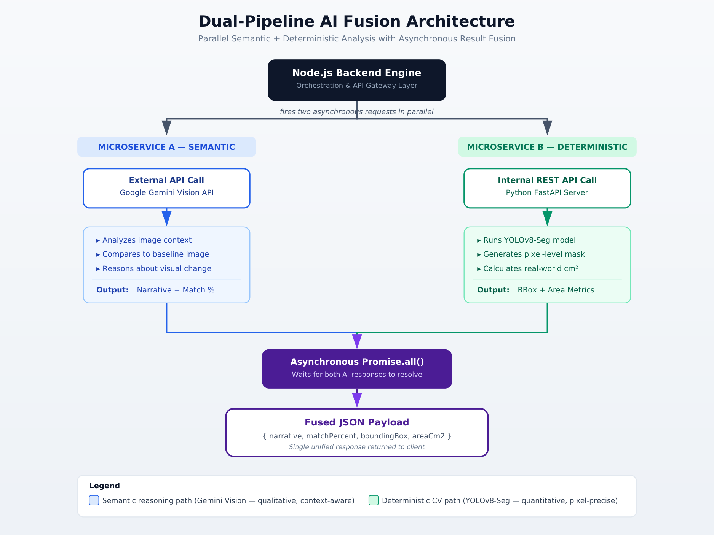
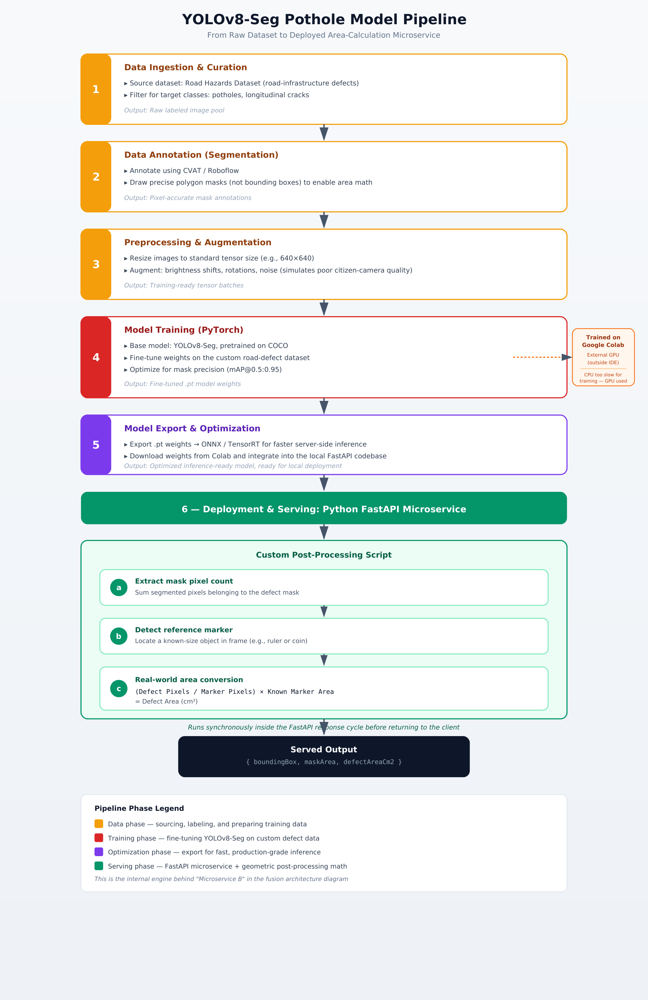
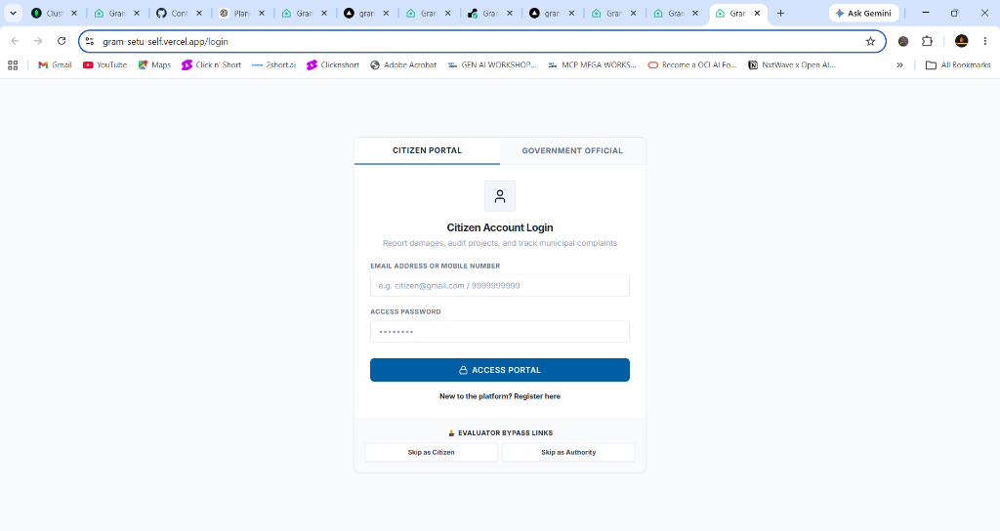
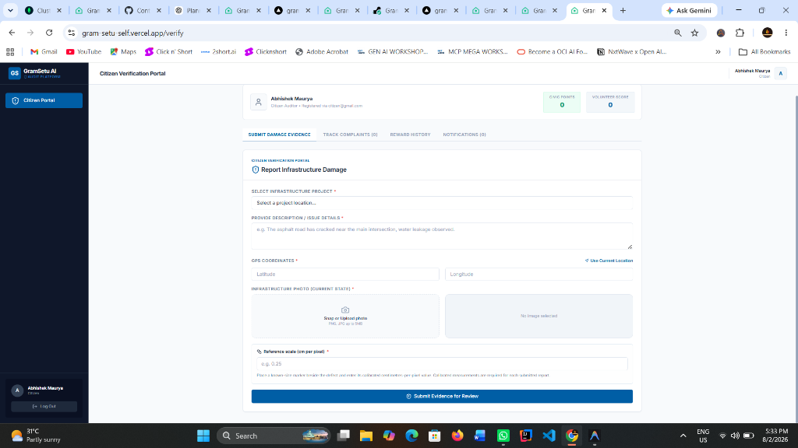
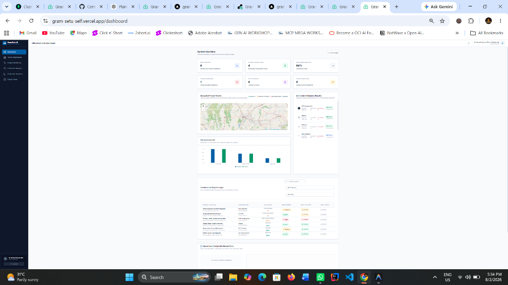

# GramSetu AI — GovTech Infrastructure Verification & Audit Platform

GramSetu AI is a next-generation GovTech enterprise platform designed for auditing, monitoring, and validating public infrastructure works. By combining a **Clean Architecture** codebase, **Dual-Pipeline AI Fusion (Gemini Vision + YOLOv8-Seg)**, and role-based access control, GramSetu AI connects citizens, inspectors, and administrators in a closed-loop quality assurance cycle.

### 🌐 Live Deployments
* **Frontend Portal:** [https://gram-setu-self.vercel.app/](https://gram-setu-self.vercel.app/)
* **Backend API Gateway:** [https://gramsetu-31ax.onrender.com](https://gramsetu-31ax.onrender.com)

---

## 📌 Problem Statement & Limitations

Traditional municipal infrastructure management suffers from structural failures in quality control:
1. **Information Asymmetry:** Citizens have no visibility into active project budgets, contractor timelines, or quality metrics.
2. **Post-Completion Neglect:** Public works monitoring halts immediately after completion. Subsequent damages (such as road decay, water pipe leaks, or wall cracks) go unreported and unaddressed.
3. **Audit Fraud & Subjectivity:** Manual auditing is slow, lacks objective verification, and is highly prone to human bias or documentation manipulation.
4. **Passive Citizen Engagement:** Existing portal systems accept only text-based complaints, offering no automatic verification, duplicate checks, or quantitative validation.

---

## 💡 Proposed Solution

GramSetu AI addresses these issues by introducing an automated, decentralized infrastructure audit ledger:

* **Dual-Pipeline AI Fusion:** Employs a parallel verification architecture. When a report or completion photo is submitted, the backend fires asynchronous requests to:
  * **Microservice A (Semantic - Gemini Vision API):** For qualitative, context-aware visual change detection and structural reasoning.
  * **Microservice B (Deterministic - YOLOv8-Seg):** Runs a custom-trained segmentation model to detect potholes/cracks, locate reference markers, and calculate the exact defect area ($cm^2$).
* **Closed-Loop Workflows:** Connects PWD Engineers, District Authorities, Field Inspectors, and Citizens into a unified review funnel.
* **Contractor Accountability Registry:** Tracks contractor delays, budget overruns, and citizen complaints to dynamically compute a **Performance Score** and **Trust Score**.

---

## 📐 Architecture & System Design

### Clean Architecture Principles
The platform is organized into distinct layer boundaries to enforce separation of concerns, loose coupling, and high testability:

1. **Presentation Layer (Frontend Client):** React.js single-page application built with Vite and styled with tailwind. Manages UI states, mapping overlays, and dashboards.
2. **Orchestration & Gateway Layer (Backend Server):** Node.js Express server acting as the central router and pipeline coordinator. It manages session states, enforces role-based endpoint permissions, and aggregates responses.
3. **Domain & Data Access Layer (Mongoose Schemas):** Strictly defined, isolated schemas representing core business entities (Citizens, Authorities, Contractors, Projects, Tenders).
4. **AI Microservices Layer (Python FastAPI):** Standalone, high-throughput Python FastAPI microservice housing the PyTorch-based YOLOv8 segmentation pipeline and ONNX Runtime execution engine.

### 1. Dual-Pipeline AI Fusion Architecture
This diagram outlines how the Node.js backend acts as an orchestrator, firing parallel async requests to the semantic reasoning engine and deterministic computer vision microservice before fusing the results into a single payload.



### 2. YOLOv8-Seg Pothole Model Pipeline
This diagram illustrates the machine learning lifecycle: data ingestion, polygon-based CVAT labeling, model optimization (PyTorch to ONNX), and physical scale conversion logic.



---

## 🔒 Authentication & Role-Based Security

To maintain enterprise integrity, GramSetu AI implements rigid security configurations:

* **Separated Collections:** 
  * **Citizen:** Identifies users by unique email and phone numbers, managing their volunteer points and active complaint audits.
  * **Authority:** Uses unique official Employee IDs (e.g. `AUTH-2026-9021`) and maps users to specific administrative roles.
* **Secure Auth Sessions:** Uses `HttpOnly`, `SameSite=None`, `Secure` cookies to transmit JWT session tokens. This protects tokens from XSS attacks by keeping them inaccessible to client-side scripts.
* **Role-Based Routing Middleware:** Endpoints are strictly guarded depending on the official role:
  * `PWD Engineer` - Can initialize tenders and assign projects.
  * `Inspector` - Permissions to upload before/after photos and submit site reports.
  * `District Authority` - Approves contractor handovers, registers finalized infrastructure, and updates review status.
  * `Government Officer` - General oversight and analytics access.
  * `Admin` - Root-level administration.

---

## 📸 Platform Interface

### 1. Citizen Portal Login
Secure sign-in for citizens, with a separate sign-in for officials.


### 2. Citizen Verification Portal
Citizens upload geotagged photos, specify physical scale references (cm/pixel), and submit evidence to trigger automated area segmentation.


### 3. Official Authority Dashboard
Provides high-level system analytics, active Leaflet maps tracking complaints, contractor trust lists, risk score metrics, and audit tables.


---

## 🌀 Detailed Workflows

### 📢 Citizen Complaint Lifecycle
```text
Citizen Report (Image + GPS)
         │
         ▼
Duplicate & Location Check
         │
         ▼
YOLOv8-Seg Processing (Defect Segmented + Area Computed)
         │
         ▼
Status: Flagged & Pushed to Map
         │
         ▼
Authority Assigns Field Inspector
         │
         ▼
Inspector Submits Evidence Verification
         │
         ▼
Gemini Qualitative Review & Final Acceptance
         │
         ▼
Contractor Score Adjusted & Resolution Published
```

### 📍 PWD Project Monitoring Workflow
```text
Tender Published (PWD Engineer)
         │
         ▼
Contractor Awarded & Project Created
         │
         ▼
Inspector Uploads "Before" Baseline Images
         │
         ▼
Construction Completed
         │
         ▼
Inspector Uploads "After" Handoff Images
         │
         ▼
AI Fusion Analysis (After vs. Before Structural Match Score)
         │
         ▼
District Authority Handover Approval
```

---

## 🛠️ Local Installation & Setup

### Prerequisites
* **Node.js** (v18 or higher)
* **MongoDB** (Running instance or MongoDB Atlas Connection String)
* **Python** (3.10 or higher)
* **Gemini API Key** (from Google AI Studio)

---

### 1. Backend Setup (`server/`)
1. Navigate to the server folder:
   ```bash
   cd server
   ```
2. Install package dependencies:
   ```bash
   npm install
   ```
3. Create a `.env` file in `server/` using the following template:
   ```env
   PORT=5000
   MONGODB_URI=mongodb+srv://<username>:<password>@cluster.mongodb.net/gramsetu
   JWT_SECRET=your_jwt_secret_token
   GEMINI_API_KEY=your_gemini_api_key
   CLOUDINARY_CLOUD_NAME=your_cloudinary_cloud_name
   CLOUDINARY_API_KEY=your_cloudinary_api_key
   CLOUDINARY_API_SECRET=your_cloudinary_api_secret
   SEGMENTATION_SERVICE_URL=http://localhost:8001
   CLIENT_ORIGINS=http://localhost:3000
   SEED_DB=true
   ```
   `CLIENT_ORIGINS` is a comma-separated list of front-end URLs allowed to call the API. `SEED_DB=true` seeds demo data only when the database is empty; `force` wipes and reseeds, and leaving it unset (as in production) never seeds.
4. Start the server:
   ```bash
   npm run dev
   ```

---

### 2. Python AI Segmentation Service Setup (`segmentation-service/`)
1. Navigate to the segmentation service folder:
   ```bash
   cd segmentation-service
   ```
2. Create and activate a python virtual environment:
   ```bash
   python -m venv .venv
   # Windows:
   .\.venv\Scripts\Activate.ps1
   # macOS/Linux:
   source .venv/bin/activate
   ```
3. Install model requirements:
   ```bash
   pip install -r requirements.txt
   ```
4. Start the FastAPI microservice:
   ```bash
   uvicorn app:app --port 8001 --reload
   ```

---

### 3. Frontend Setup (`client/`)
1. Navigate to the client folder:
   ```bash
   cd client
   ```
2. Install client dependencies:
   ```bash
   npm install
   ```
3. Start the Vite React app:
   ```bash
   npm run dev
   ```
4. Open your browser to the local address displayed (default is `http://localhost:3000`).

---

## 👥 Contributors

* **Mohd Abid Hussain** (Lead Developer)
* **Bibhuti Parida** (AI & ONNX Integration)
* **Ramu1029** (Project Lifecycle Developer)
