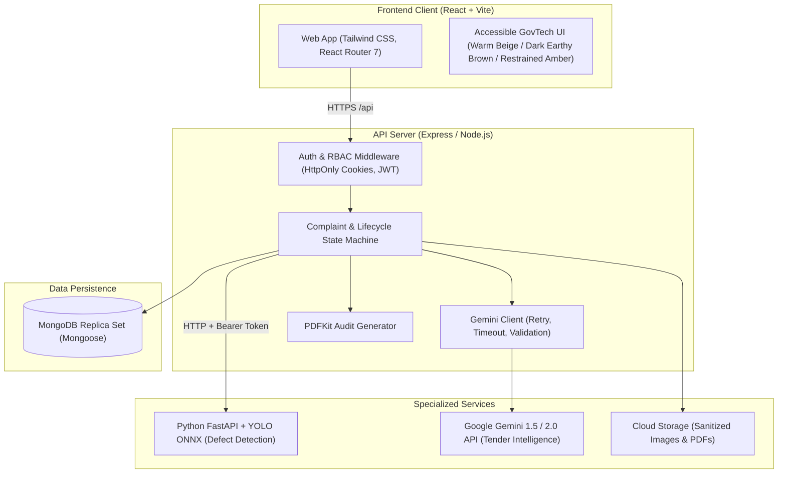
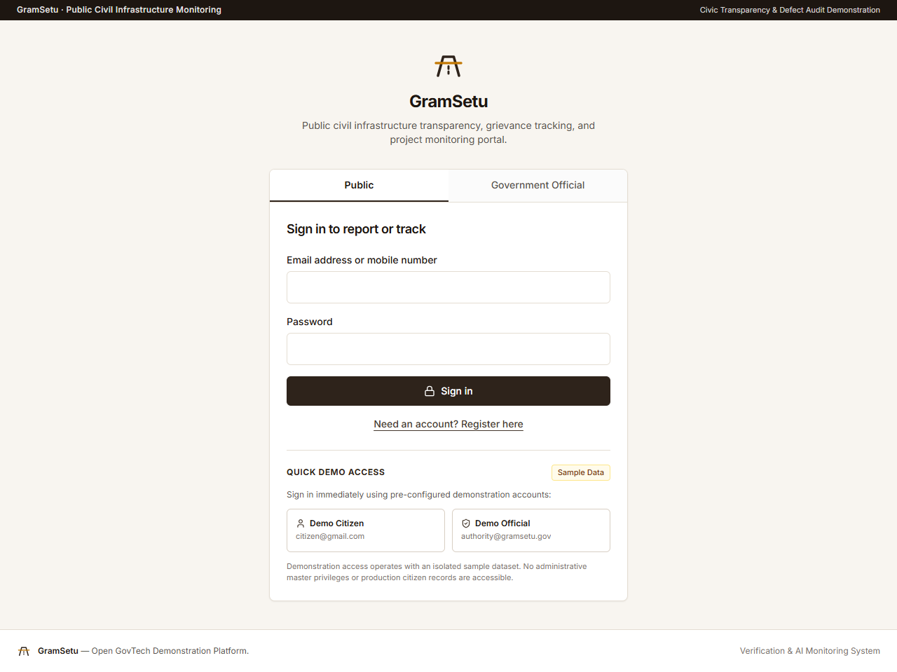
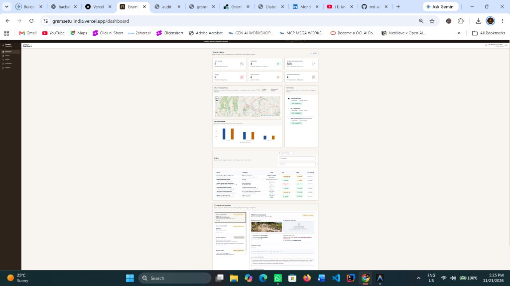
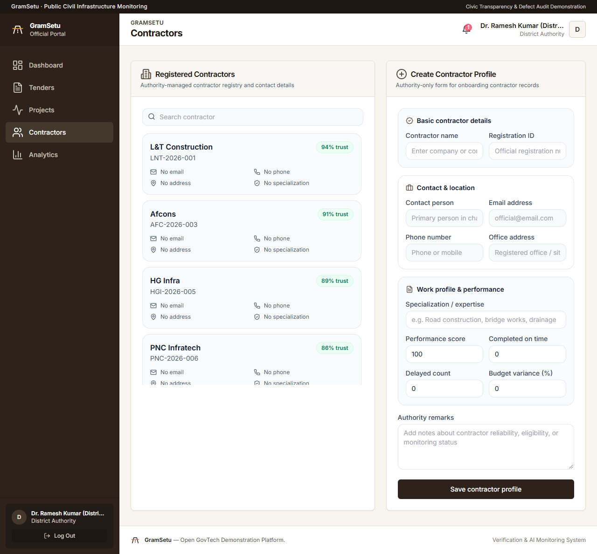
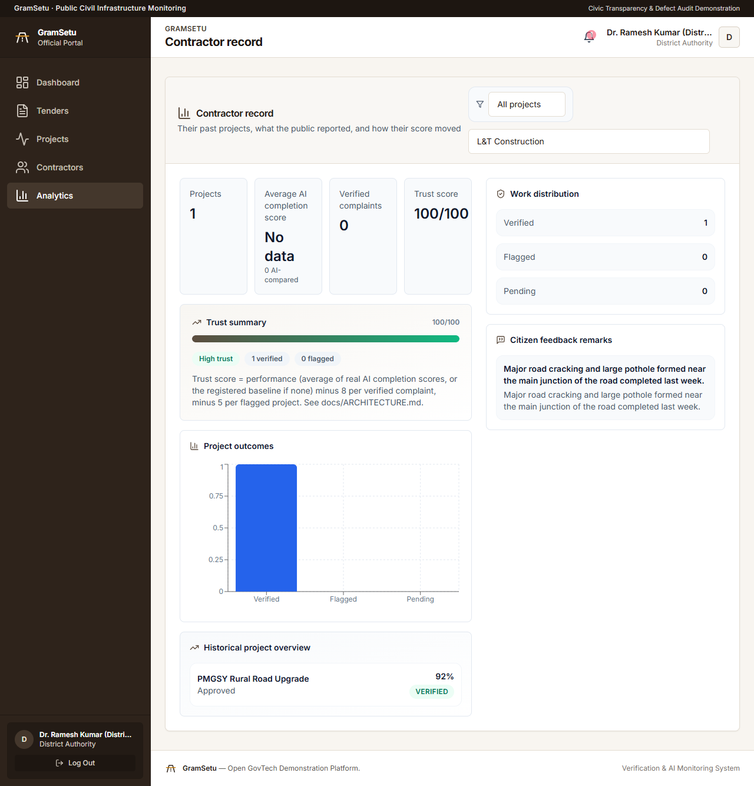
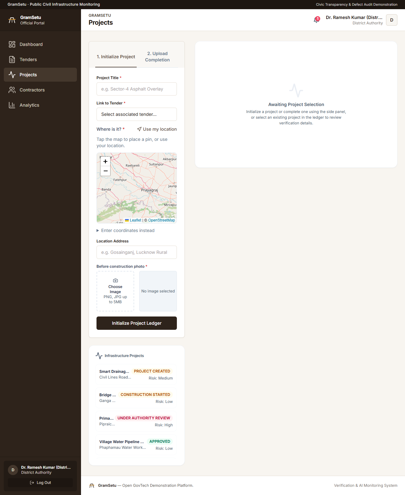
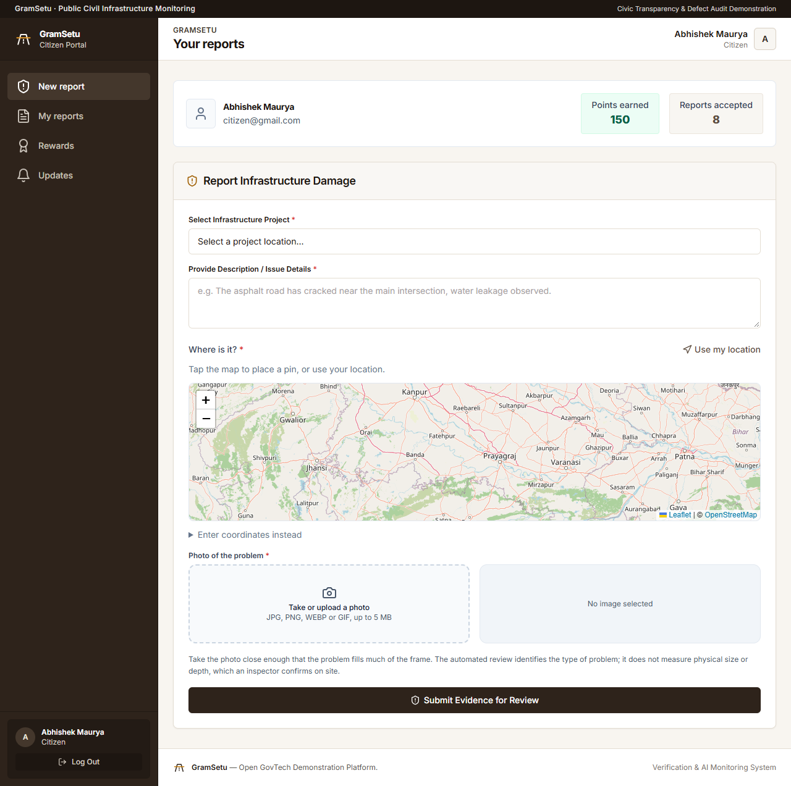

# GramSetu

Public Infrastructure Monitoring and Citizen Reporting GovTech Platform.

GramSetu improves transparency and accountability in public works through verified citizen reporting, automated road defect detection (YOLOv8 bounding boxes), and AI-assisted tender analysis.

- Repository: https://github.com/md-abidhussain/GramSetu
- Live Deployment: https://gramsetu-india.vercel.app
- Backend API: https://gramsetu-31ax.onrender.com

---

## 1. Project Overview

GramSetu is an open GovTech system designed to monitor civil infrastructure delivery across Indian urban and rural local bodies (Panchayats and Municipalities). The platform connects citizens, municipal authorities, field inspectors, and civil contractors into a closed-loop verification workflow. Citizens report infrastructure failures (such as potholes, open manholes, or broken pavements) with photos and GPS coordinates. Municipal authorities dispatch inspectors for physical verification, and civil works completion is audited using before-and-after image comparison and AI defect analysis.

---

## 2. Problem Statement

Public infrastructure management in local governance often suffers from several systemic bottlenecks:
- **Delayed Reporting**: Grievances take weeks or months to reach relevant executive engineers through manual paper registers.
- **Verification Gaps**: Reports often lack verifiable ground truth evidence (exact coordinates, timestamped photographs, and objective defect measurements).
- **Contractor Accountability**: Contractor reputations are rarely linked dynamically to past field performance or verified community defects.
- **Tender Opacity**: Complex procurement documents make it challenging to audit compliance terms, timelines, and defect liability periods.

GramSetu addresses these challenges by combining structured grievance state machines, objective computer vision defect detection, and large language model tender extraction into a verifiable audit trail.

---

## 3. Key Features

- **Citizen Reporting**: Report civil defects with photographs, description, and GPS coordinates. Privacy is protected by automatically stripping EXIF and device metadata prior to storage.
- **Closed-Loop Verification Engine**: Formal state machine for grievance tracking: `Submitted` -> `UnderReview` -> `InspectorAssigned` -> `Accepted` / `Rejected` -> `Resolved`.
- **Incentive & Civic Points**: Verified complaints award civic reward points to citizens via idempotent database transactions to prevent double-crediting.
- **Road Defect Detection Microservice**: Lightweight FastAPI service running a trained YOLOv8 ONNX model to detect potholes, cracks, and open manholes via bounding boxes. Every response is honestly categorized as `real_inference`, `demo_simulation`, or `model_unavailable` (HTTP 503).
- **Tender Intelligence with Gemini AI**: Structured extraction of tender liability periods, milestones, and penalty clauses from uploaded PDF documents with schema validation and fallback safety.
- **Civil Infrastructure Lifecycle Tracking**: Milestone tracking from initial tender award to maintenance handover, disallowing arbitrary bypassing of required verification stages.
- **Contractor Performance Scorecard**: Dynamic scoring (0 to 100) combining project delivery history and verified citizen grievances.
- **Automated PDF Audit Reports**: Printable inspection summaries for district authorities and municipal review meetings.

---

## 4. System Architecture



---

## 5. Technology Stack

- **Frontend Client**: React 18, Vite, React Router 7, Tailwind CSS, Lucide Icons, Leaflet / React-Leaflet, Recharts, Vitest, Testing Library.
- **Backend API**: Node.js 22+, Express 4, Mongoose 8, JWT, bcryptjs, Multer, Helmet, Express Rate Limit, PDFKit, pdf-parse.
- **AI & Computer Vision**: Google Gemini Generative AI SDK, Python 3.11+, FastAPI, Ultralytics YOLOv8, ONNX Runtime, OpenCV, NumPy.
- **Database & Storage**: MongoDB Atlas, Cloudinary (with optional local disk fallback for development).
- **Testing & Quality Assurance**: Node test runner (`node:test`), Supertest, MongoDB Memory Server, Vitest, Playwright, Pytest.

---

## 6. Directory Structure & Module Responsibilities

```
GramSetu/
├── client/                     # Frontend Single Page Application
│   ├── src/
│   │   ├── components/         # UI components (citizen, monitoring, layout, ui)
│   │   ├── context/            # AuthContext (cookie-based session state)
│   │   ├── lib/                # A11y helpers, AI status formatters, date utilities
│   │   ├── pages/              # Route pages (Login, Dashboard, Verify, Monitoring, Tenders)
│   │   └── services/           # Axios/Fetch API client wrappers
│   ├── e2e/                    # Playwright end-to-end browser journeys
│   └── vite.config.js          # Vite build and proxy configuration
├── server/                     # Backend REST API Server
│   ├── config/                 # Environment validation (env.js) and database connection (db.js)
│   ├── controllers/            # Request handlers (auth, citizen, project, tender, contractor)
│   ├── middleware/             # Auth guards (protect, restrictTo), rate limiters, error handling
│   ├── models/                 # Mongoose schemas (Citizen, Authority, Project, Tender, Report)
│   ├── routes/                 # Express feature routers
│   ├── services/               # AI integration (Gemini), segmentation client, PDF generator
│   ├── utils/                  # State machines, severity rules, EXIF stripper, logger
│   └── tests/                  # Unit and HTTP integration tests
├── segmentation-service/       # Python Microservice for Road Defect Detection
│   ├── models/                 # Committed ONNX model weights (model.onnx)
│   ├── app.py                  # FastAPI application endpoints (/health/ready, /segment)
│   ├── inference.py            # Image decoding, YOLO ONNX inference, honest measurements
│   ├── settings.py             # Pydantic environment configuration
│   └── tests/                  # Pytest unit and integration test suites
├── assets/                     # Brand identity and visual assets
│   └── branding/               # Vector brand assets, SVG logo, and icons
├── test-assets/                # Single unified test folder: sample infrastructure images (before/after), defect photos, and tender PDFs
├── docs/                       # Technical architecture and compliance documentation
│   ├── ARCHITECTURE.md         # Detailed architectural specification
│   ├── SECURITY.md             # Security controls, session lifecycle, and risk mitigations
│   ├── AI_LIMITATIONS.md       # Documented AI constraints and non-measurement boundaries
│   ├── TESTING.md              # Test layer documentation and instructions
│   ├── DEPLOYMENT.md           # Production deployment runbooks
│   ├── screenshots/            # Live application captures for documentation
│   └── teamContributions/      # Authorship and team contribution records
│       └── CONTRIBUTIONS.md
├── scripts/                    # Automation and screenshot generation scripts
├── .env.example                # Root environment guide
└── README.md                   # System documentation
```

---

## 7. Application Screenshots & Visual Evidence

The live deployment (https://gramsetu-india.vercel.app) has been verified end-to-end. Below are actual screenshots captured from the live deployed application:

| Citizen Sign-in & Quick Demo Access | Official Oversight Dashboard |
| :---: | :---: |
|  |  |

| Contractor Performance Registry | Contractor Deep-Dive Analysis View |
| :---: | :---: |
|  |  |

| Civil Infrastructure Projects Monitoring | Citizen Grievance Ground Verification |
| :---: | :---: |
|  |  |

---

## 8. Installation & Local Setup

### Prerequisites
- Node.js version 22 or higher
- Python version 3.11 or higher (optional, required only for defect detection)
- MongoDB instance (MongoDB Community locally or MongoDB Atlas free tier)

### 1. Clone the Repository
```bash
git clone https://github.com/md-abidhussain/GramSetu.git
cd GramSetu
```

### 2. Install Dependencies
```bash
# Installs root, server, and client dependencies
npm run install:all
```

---

## 9. Environment Variables

Create environment configuration files for the components:

### Server Configuration (`server/.env`)
```env
PORT=5000
NODE_ENV=development
MONGODB_URI=mongodb://127.0.0.1:27017/gramsetu
JWT_SECRET=your_secure_development_jwt_secret_at_least_32_characters_long
CLIENT_ORIGINS=http://localhost:3000

# File Storage (local driver skips Cloudinary during local development)
STORAGE_DRIVER=local

# Google Gemini API Key (optional; gracefully reports not_configured if omitted)
GEMINI_API_KEY=

# Segmentation Microservice (optional)
SEGMENTATION_SERVICE_URL=http://localhost:8001
SEGMENTATION_SERVICE_TOKEN=
SEGMENTATION_MIN_CONFIDENCE=0.35

# Deterministic Seed Data
SEED_DB=true
ADMIN_PASSWORD=admin_demo_password_123
ADMIN_EMAIL=admin@gramsetu.gov
```

### Client Configuration (`client/.env`)
```env
# Optional: In development, Vite automatically proxies /api to http://localhost:5000
VITE_API_BASE_URL=
```

### Defect Microservice Configuration (`segmentation-service/.env`)
```env
SEGMENTATION_ENV=development
MODEL_PATH=models/model.onnx
SEGMENTATION_DEMO_MODE=false
SEGMENTATION_SERVICE_TOKEN=
MAX_UPLOAD_MB=8
```

---

## 10. Database Setup & Deterministic Seeding

GramSetu features deterministic seed data in `server/data/seedDatabase.js`.
When `SEED_DB=true` is set in `server/.env`, starting the server populates the database with:
- Demo Authority: `authority@gramsetu.gov` / `authority123` (Role: District Authority)
- Demo Inspector: `inspector@gramsetu.gov` / `inspector123` (Role: Inspector)
- Demo Citizen: `citizen@gmail.com` / `citizen123`
- Realistic sample projects, civil tenders, and synthetic contractor performance records.

All seeded records are explicitly stamped with `dataSource: "sample"` and `aiAssessment.status = "sample_data"` so sample records are never confused with real AI analysis.

---

## 11. Development Commands

```bash
# Run both Backend API (:5000) and Frontend Vite (:3000) concurrently
npm run dev

# Run only Backend API with nodemon
npm run dev:server

# Run only Frontend client with Vite
npm run dev:client

# Start Python Defect Detection Microservice (:8001)
cd segmentation-service
uvicorn app:app --port 8001 --reload
```

---

## 12. Automated Testing Suite

The repository maintains automated test suites across all layers.

### Server Test Suite
```bash
# Run 132 unit and domain rule tests
npm run test:unit --prefix server

# Run linting check
npm run lint --prefix server
```

### Client Test Suite
```bash
# Run Vitest component tests (48 tests across 10 suites)
npm test --prefix client

# Run client production build
npm run build --prefix client

# Run Playwright E2E test journeys (requires running backend & MongoDB)
cd client && E2E_MONGODB_URI=mongodb://127.0.0.1:27017/gramsetu_e2e npm run test:e2e
```

### Python Defect Detection Microservice Tests
Tests are divided into fast unit suites and model integration tests:
```bash
cd segmentation-service

# Run lightweight unit tests (image decode, bounding-box parsing, scaling, mock detector)
pytest tests/test_inference_unit.py -v

# Run model integration test using local model.onnx weights
pytest tests/test_inference_real_model.py -v
```

---

## 13. API Endpoint Summary

| Method | Endpoint | Access Level | Description |
| :--- | :--- | :--- | :--- |
| `POST` | `/api/auth/citizen/register` | Public | Citizen account registration |
| `POST` | `/api/auth/citizen/login` | Public | Citizen sign-in; issues HttpOnly cookie |
| `POST` | `/api/auth/authority/login` | Public | Official / Inspector sign-in; issues HttpOnly cookie |
| `POST` | `/api/auth/logout` | Authenticated | Revokes session via `tokenVersion` and clears cookie |
| `GET` | `/api/auth/me` | Authenticated | Returns current authenticated user session |
| `POST` | `/api/citizen/reports` | Citizen | Submits grievance with photo, description, and GPS coordinates |
| `GET` | `/api/citizen/my-reports` | Citizen | Retrieves grievances submitted by the logged-in citizen |
| `GET` | `/api/citizen/reports` | Official, Inspector | Lists grievances across the jurisdiction with pagination |
| `PATCH` | `/api/citizen/reports/:id/decision` | Official | Takes official action (`Accepted`, `Rejected`, `InspectorAssigned`) |
| `POST` | `/api/citizen/reports/:id/inspection` | Assigned Inspector | Submits ground verification photo and inspection notes |
| `GET` | `/api/projects` | Public / Authenticated | Public projects list (strips contractor phone and internal PDFs) |
| `POST` | `/api/tenders` | Official, Admin | Uploads tender PDF and initiates Gemini extraction |
| `GET` | `/api/contractors` | Official, Contractor | Retrieves contractor performance leaderboard |
| `GET` | `/api/dashboard/overview` | Official, Admin | Aggregated metrics on active works, risks, and complaints |
| `GET` | `/api/health/ready` | Public | Service readiness probe |

---

## 14. AI Integration & Honest Reporting

GramSetu isolates all AI operations from primary transactional business logic.

### 1. Tender Intelligence & Image Comparison (`server/services/ai/`)
- Powered by Google Gemini via an isolated client wrapper.
- Structured response schemas validate keys, types, and value bounds using JSON schemas.
- Non-transient errors (invalid keys, bad requests) fail fast; transient network errors use bounded exponential backoff.
- **Graceful Fallback**: If `GEMINI_API_KEY` is omitted or quota is exhausted, the system records `aiAssessment.status = "not_configured"` or `"unavailable"`. The application continues without crashing, storing the upload safely and allowing manual review.

### 2. Defect Detection Microservice (`segmentation-service/`)
- Powered by a YOLOv8 ONNX model exported for CPU inference, producing object bounding boxes for potholes, cracks, and open manholes (not pixel-level segmentation masks).
- Every detection specifies `measurementBasis` (`bounding_box` or `mask`).
- Physical dimensions (`cm`, `cm²`) are calculated only when an optional physical calibration scale (`scale_cm_per_pixel`) is supplied. Depth is explicitly reported as `None` because single-view 2D RGB imagery cannot measure optical depth.

---

## 15. Security Architecture

- **Session Security**: Pure `HttpOnly`, `SameSite=Lax` (or `Strict`), and `Secure` (in production) cookies. Token credentials are never returned in JSON response bodies or stored in `localStorage`.
- **Authorization Guarding**: Every administrative or protected endpoint is protected on the server by `protect` and `restrictTo` middleware. Route security does not rely on client-side state.
- **Privacy Protection**: Citizen image uploads are processed through `stripImageMetadata.js` using buffer-level JPEG EXIF (APP1) markers removal to strip embedded GPS and camera metadata before storage.
- **Rate Limiting**: Bounded rate limiters on authentication attempts, file uploads, and general API routes, with `TRUST_PROXY` support for proxy deployments.
- **Database Safety**: Rejection of Malformed ObjectIDs at the parameter validation layer (`validateIdParam.js`) to prevent unhandled driver errors.

---

## 16. Known Limitations

- **Depth Perception**: Optical defect depth cannot be determined from a single standard photograph without stereo imaging or LiDAR sensors.
- **Detector Training Scope**: The committed ONNX detector weights were trained on a specific 3-class dataset (`pothole`, `crack`, `open_manhole`). Novel defect types require model retraining.
- **Offline Mode**: Reporting in rural areas with poor connectivity requires client-side caching, which is planned for future offline-first Progressive Web App (PWA) releases.

---

## 17. Team Contributions

GramSetu is a collaborative project developed for the NxtWave Idea2Impact Hackathon.

Detailed authorship, individual responsibilities, and refactoring history are fully documented in:
[docs/teamContributions/CONTRIBUTIONS.md](docs/teamContributions/CONTRIBUTIONS.md)

### Summary of Responsibilities
- **Mohd Abid Hussain** (`md-abidhussain`): System Architect & Lead Developer. Authored full-stack system architecture, RBAC, Gemini AI integration layer, state machines, automated test harness, security hardening, and GovTech UI overhaul.
- **Bibhuti Kumar Parida** (`bibhuti-parida`): Contributed the initial Python defect detection service, trained ONNX weights, and PDF audit report generator.
- **Ramu1029** (`Ramu1029`): Contributed the initial project lifecycle tracking module and contractor registry forms.

---

## 18. Deployment & Hosting

- **Frontend**: Deployed on Vercel (`client/`). Rewrites `/api` to the backend Express service.
- **Backend**: Deployed on Render (`server/`).
- **Defect Detection**: Containerized via `segmentation-service/Dockerfile` for deployment on Google Cloud Run or Render.
- Deployment runbooks and environment setup instructions are documented in [docs/DEPLOYMENT.md](docs/DEPLOYMENT.md).
