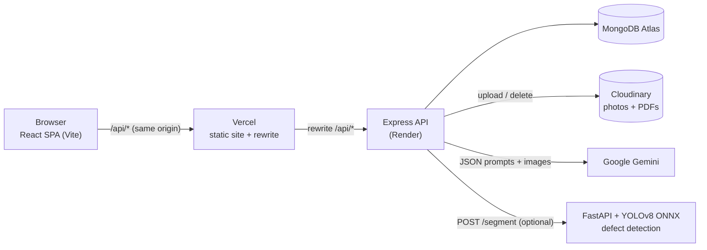

# Architecture

GramSetu has three deployable parts and three external services.



| Part | Folder | Responsibility |
| --- | --- | --- |
| Client | `client/` | Screens for citizens and officials. Holds no secrets and no tokens. Route guards only keep screens consistent; the server decides access. |
| API | `server/` | Authentication, authorization, validation, workflow rules, persistence, calls to AI and storage. |
| Detector | `segmentation-service/` | Runs the YOLO model on one photo. Stateless. Says whether output is real, simulated or unavailable. |

## Server layout

```
server/
  server.js          process start: validate config, connect DB, optional seed, listen, graceful shutdown
  app.js             Express app (no I/O): security headers, CORS/CSRF, body limits, health, routes, errors
  config/            env validation (pure function), DB connection
  routes/            URL -> middleware chain -> controller. Reads as a permissions table.
  middleware/        session, roles, uploads (+ byte signature check), id validation, rate limits, errors
  controllers/       request handling: validate input, apply rules, call services, shape the response
  services/          external systems (Gemini, Cloudinary, detector) and cross-entity logic (contractor score, notifications, PDFs)
  utils/             pure rules: access, workflows, severity, validators, geo, pagination, logger
  models/            Mongoose schemas and indexes
  tests/unit, tests/http
```

The split that matters most is **pure rules in `utils/`**: who may see a complaint,
which workflow step is allowed, how severity is derived. They are plain
functions, so they are unit tested without a database. HTTP tests then check
that each route actually uses them.

## Request lifecycle: a citizen files a complaint

1. **Browser.** `CitizenReportForm` builds `FormData` (project, description, lat/lng, photo) and calls `request('/citizen-reports')` (`client/src/services/api.js`). The browser attaches the `token` cookie itself.
2. **Vercel** rewrites `/api/citizen-reports` to the Render API, so the cookie is first-party.
3. **`app.js`.** Request id and log line; helmet; CORS/Origin check (403 for foreign sites); global rate limit; upload rate limit for writes.
4. **`routes/citizenRoutes.js`.** `protectCitizen` verifies the JWT (HS256, `kind`, `tokenVersion`) and loads the citizen (401/403 otherwise). Then `uploadImage` (multer: one file, ≤ 5 MB) and `verifyImageContents` (the file's first bytes must be JPEG/PNG/WebP/GIF).
5. **`createCitizenReport`** validates fields, loads the project and computes the distance to it (≤ 150 m means geo-verified). It checks for a nearby open complaint (possible duplicate). It then runs **in parallel** the Gemini review (photo vs the project's photo) and the detector. Severity comes from real evidence only. The photo is stored (EXIF stripped) and the report saved with each AI result's `status`. Project and contractor scores are **not** touched yet.
6. **Response.** 201 with the saved report. Officials of the deciding roles get a notification.
7. Later, an official assigns the assigned inspector, who uploads evidence (AI repair check). The official accepts. A transaction publishes the resolution, pays the reward once, updates the project and recalculates the contractor's score.

## Data model

| Collection | Key fields | Indexes (and the query each serves) |
| --- | --- | --- |
| `citizens` | name, email/phone (unique, sparse), passwordHash, points, badges, tokenVersion | unique email, unique phone |
| `authorities` | name, email, uniqueUserId, role, tokenVersion | unique email/uniqueUserId; role (inspector list) |
| `citizenreports` | citizen, project, gps, aiAssessment + AI fields, segmentation, severity, status, assignedOfficer, repairAssessment, rewardGranted, dataSource | {citizen, createdAt} my reports; {assignedOfficer, status} inspector queue; {createdAt} dashboard; {project} contractor scoring; {status, gps.lat, gps.lng} duplicate check |
| `projects` | title, tender, contractor, location, before/after URLs, aiAssessment, completionScore, lifecycleStatus, statusHistory | createdAt, contractor, tender |
| `tenders` | title, contractor, fileUrl, extractedText (not selected by default), aiAssessment + AI fields | createdAt, contractor |
| `contractors` | registrationId (unique), baselineScore, performanceScore, trustScore | trustScore (leaderboard) |
| `rewards` | citizen, complaint (unique when present), amount | complaint unique; {citizen, createdAt} |
| `notifications` | user + userModel (refPath), message, read | {user, createdAt} |

## Workflows

**Complaint** (`utils/complaintWorkflow.js`): Authority Notification / Duplicate
Detected → Inspector Assigned → Inspection Scheduled → Inspector Uploads
Verification → Resolution Published | Rejected | Need More Evidence (back to
inspection). Rejection is also allowed before inspection (spam, wrong
jurisdiction). Every step is a conditional update on the current status, so
two concurrent requests cannot both apply.

**Project** (`utils/projectLifecycle.js`): Project Created → Construction
Started → *Waiting for AI Verification* → *AI Verified* → Citizen Verification →
Under Authority Review → Approved | Rejected | Maintenance Required. The two
italic stages are system-only: they happen when a completion photo is uploaded
and a real AI comparison succeeds.

## Contractor score (one formula)

`services/contractorScoreService.js` `computeContractorScores`:

```
performance = average completion score of projects with a REAL AI comparison
              (or the baseline score an official entered, if none)
              - 8 x complaints an official accepted
trust       = performance - 5 x currently flagged projects        (both clamped 0..100)
```

The same function feeds the stored score and the analysis page, so they cannot
disagree. (There used to be three different formulas.)

## Design decisions

These are the decisions in the code today and why they were made. Ones marked
*(recommendation)* are not implemented.

- **Monolith API + one ML microservice.** The detector has different runtime needs (Python, ONNX, CPU-heavy) and is optional, so it is separate. Everything else is one Express app; no queues or caches without a measured need.
- **Cookies, not localStorage.** HttpOnly cookies cannot be read by injected scripts. Vercel's rewrite makes the API same-origin, so `SameSite=Lax` works.
- **Arrays plus pagination headers** (`X-Total-Count`) instead of changing every list response shape, so the client did not need rewriting.
- **Transactions only where several writes must agree** (accepting a complaint). Elsewhere a conditional single-document update is enough.
- *(recommendation)* Background job queue for AI calls if traffic grows: today a slow AI call holds the HTTP request for up to ~75 s.
- *(recommendation)* Signed, expiring Cloudinary URLs for citizen photos.
